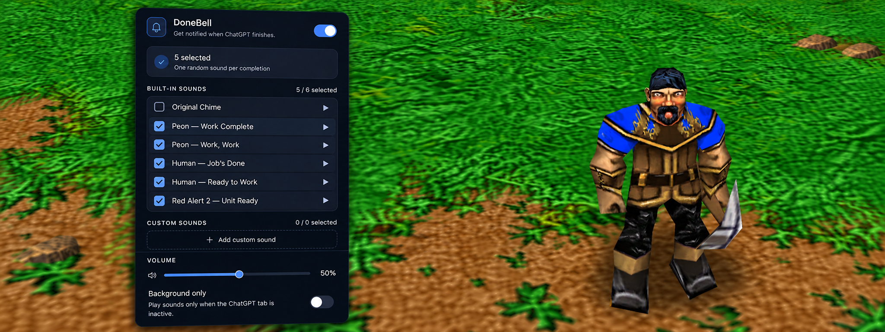

# 🔔 DoneBell

**A customizable completion sound for ChatGPT in Chrome.**

DoneBell plays a notification when ChatGPT finishes responding, so you can focus on other things while waiting.



_Preview shows a personal build with additional game sounds. The public release includes Original Chime only._

## Features

- 🔔 Get notified when ChatGPT finishes responding.
- 🎵 Select multiple sounds for randomized playback.
- 📁 Import your own MP3 or WAV sounds.
- 🔊 Adjustable volume.
- 🖥️ **Background Only** mode to skip alerts when the ChatGPT tab is active.
- 🔒 Fully local, with no tracking or network requests.

## Installation

1. Download the latest ZIP from [GitHub Releases](https://github.com/xafm/donebell/releases).
2. Extract it into a permanent folder.
3. Open `chrome://extensions` in Chrome.
4. Enable **Developer mode**.
5. Click **Load unpacked** and select the extracted folder.
6. Open or reload [ChatGPT](https://chatgpt.com/).

Requires Chrome 116 or newer.

## Optional Game Sounds

I'm a big fan of the classic voice lines from **Warcraft III** and **Command & Conquer: Red Alert 2**.

Unfortunately, I couldn't include these sounds in the public release due to copyright restrictions. You can find them on Myinstants and import them yourself:

**Warcraft III**

- [Peon — Work Complete](https://www.myinstants.com/en/instant/orc-peon-work-complete/)
- [Peon — Work, Work](https://www.myinstants.com/en/instant/warcraft-peon-work-work/)
- [Human — Job's Done](https://www.myinstants.com/en/instant/jobs-done-peasant/)
- [Human — Ready to Work](https://www.myinstants.com/en/instant/ready-to-work-human-peasant-34867/)

**Red Alert 2**

- [Unit Ready](https://www.myinstants.com/en/instant/red-alert2-unit-ready-89816/)

Download the MP3 files and use **Add custom sound** in DoneBell to import them.

These sounds belong to their respective copyright holders. Availability for download does not grant redistribution or other usage rights.

## Development

```bash
git clone https://github.com/xafm/donebell.git
cd donebell
npm ci
npm run build
```

Load the generated `dist/` folder in Chrome.

To create a public release:

```bash
npm run build:release
```

## Privacy & Limitations

DoneBell doesn't read, store, or transmit your conversations. All settings and imported sounds stay in your browser.

Completion detection relies on ChatGPT's interface rather than an official API, so interface changes may occasionally affect notifications.

## License

Licensed under the [MIT License](LICENSE).

Detection logic incorporates the [Chat Dinger](https://github.com/rumblelab/chatdinger) approach. See [THIRD_PARTY_NOTICES.md](THIRD_PARTY_NOTICES.md).

Third-party audio and imagery are excluded from DoneBell's MIT license.

DoneBell is an independent project, not affiliated with or endorsed by OpenAI.
